# Maker — Product Audit: Bundles, Learning, Theme

Oct 27, 2026, revised Oct 28 (v3.1) · @zoz · Live doc: https://claude.ai/artifact/A3JMhTS3oYUSs2rMPMow1A · Motion preview: https://claude.ai/artifact/PiAHiooVUVU9AhxevNU5yA · Mark canvas: https://claude.ai/artifact/W2JEsep63Vsiow4DXidLff

> Primary reference for this handoff. It builds on `docs/design/maker-ui-handoff/` (v2): the spread identity, venue neutrality and copy rules still hold. Where they differ, this document and `mockups/maker3.css` win.

## Summary

The spread-identity redesign shipped and the desk is clearer. The product still expects you to think like the engine, though: it shows what Maker is doing but not why, it runs one strategy per wallet, and dark mode is unreliable. Five changes fix that.

**Reviewed:** `main` at `6499d06`, which includes PRs #1 to #6. I also reviewed the open branch `fix/wallet-control-and-theme` (`f3c9afb`). I built both locally and drove every view with the repo's own browser fixtures, in light and dark, at 1440 px and 390 px. No production API was called.

**What landed well:**

- the tokens, the mark and the venue chips
- a Stop button that stays enabled mid-action; the harness tested this with a 409 response
- the Go-Live sheet
- sortable Markets
- the phone dock
- a contrast harness on the open branch

**What's off:**

- **Dark mode and theme.** The worst problems are a white-on-coral Stop button (2.8:1) and a selected chip whose text is invisible (1.1:1).
    - The rest are 78 secondary-text runs per theme that fall below AA.
    - 330 of the 684 text runs are smaller than 12 px.
    - Performance, Accounts and the Markets table were restored from the old UI and never moved onto the new components.
    - The main cause is the `Graphite 3` token I specified, which fails AA in both themes. I've corrected it below.
- **Nothing explains itself.** "Quoting", "queued", "Run drawdown: not reported" and an unlabeled dollar column leave you guessing.
- **Strategy is one long form.** It's 2,600 px with about 30 controls. Run drawdown sits in a collapsed Advanced section, and nothing on the desk links to it.
- **One strategy per wallet.** The config holds one maker account and one hedge account, so you can't run two approaches side by side.
- **Performance has no volume view.** "Reward efficiency" mixes two different things: your account's reward stats and a ranking of markets.

**The five changes:**

1. **Bundles.** A bundle pairs a maker account with a taker account and gives them one strategy. Several can run at once, under shared wallet limits and one Stop all.
2. **Learning built in.** A live "Right now" sentence on the desk, an Explain switch that puts numbered notes on the screen, and a Learn page built around the animation.
3. **A strategy builder inside each bundle.** Five short steps instead of one long form. Market quick picks come straight from the reward ranking, and every limit reads as a sentence.
4. **Performance that answers "how much did I trade and earn".** Volume by market that expands to show the fills, rewards explained in plain words, and a by-bundle comparison.
5. **One theme with motion.** Corrected tokens, every panel on the same components, a redrawn mark, and an animation of the market being made that opens on that mark. The animation is used on the landing page, the desk and the Learn page.

The landing page is rebranded as your own market-making desk, working for you.

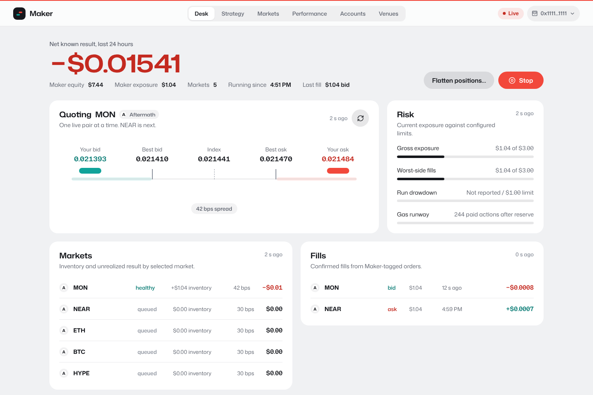

## Your notes, answered

Each of your notes points to something the code really does. Here is what causes each one and what fixes it.

| Your note | What's going on today | Fix |
| --- | --- | --- |
| Bundles: pair two accounts as maker and taker, run several strategies | The config has one `makerAccountId` and one `hedge.accountId`, and there's one runtime per wallet | Bundles: a maker, a taker and a strategy, several at once (spec below) |
| "I'm looking at it and don't understand" | Labels are the engine's own words: "healthy", "queued", "244 paid actions after reserve". Nothing says why something happened | A "Right now" sentence, an Explain switch, a ? on every term, and a Learn page |
| Reward efficiency isn't intuitive | One card mixes your account's rewards with a market ranking. "Qualifying snapshots" shows 0.962, which reads as a fraction, not a count | Split it: a Rewards card in plain words, and the ranking renamed "Reward potential" and moved into market picking |
| Performance should show volume, broken down by market | Only $14.51 attributed notional, plus a footnote with account-wide volume | Volume by market, split into maker and taker, with each row expanding to its fills, plus a by-bundle table |
| Strategy isn't intuitive | 10 cards and about 30 controls on one page, with Mode at the bottom | A five-step builder with a live "What Core will do" summary |
| Add a strategy to a bundle | There are no bundles yet | The strategy lives inside the bundle |
| Markets need a few one-click picks based on reward efficiency, and the two should connect | The ranking and "Stage rotation" sit on Performance, the picker sits on Strategy, and nothing links them | Quick picks in the Markets step, and "Add to bundle" on Markets rows. Both read the same scores |
| Desk: what is quoting doing? | "Quoting MON. One live pair at a time. NEAR is next." sits over a static ladder | An animated strip from real quotes and fills, with a one-line caption. Statuses read "Quoting now", "Up next, 12 s" and "Waiting its turn" |
| Where does run drawdown get set? | Strategy › Advanced (collapsed). The desk says "Not reported" even though the engine works the number out every cycle | Show the real value, link it to the bundle's Limits, and write the limit as a sentence |
| Markets has a dollar value at the end. What is it? | That market's unrealized P&L, in a list with no column headers | Headers, with a ? that explains unrealized P&L |
| Beautiful animations of the market being made | Only the mark animates | The motion system below |
| The landing page should be about your own desk working for you | "Both sides of the market, from your own wallet." | "Your own market-making desk. Working for you." over the live animation |
| Dark-mode contrast, and one theme across the app | Measured in the next section | Corrected tokens, and every panel moved onto the same components |

## Dark mode and one theme

Dark mode fails for two reasons.

- **Two of my tokens fail AA.** One is the secondary-text grey; the other is the coral Stop fill, which can't carry white text.
- **Three surfaces never moved onto the new components.** Performance, Accounts and the Markets table were restored from the old UI.

The open branch `fix/wallet-control-and-theme` fixes the five worst cases but leaves both root causes.

I measured every visible text run against its real background in each view, in both themes. These are the worst of them:

| What | Light | Dark | Needs | After the open branch |
| --- | --- | --- | --- | --- |
| Selected "All eligible" chip on Performance | passes | 1.1:1 | 4.5:1 | Fixed |
| Maker and Hedge role buttons on Accounts, white on Tide | passes | 1.9:1 | 4.5:1 | Fixed |
| Stop button, white on Ember | 3.6:1 | 2.8:1 | 4.5:1 | Dark fixed, light still fails |
| Table headers on the tinted header row (Markets, Performance) | 2.9:1 | 3.6:1 | 4.5:1 | Still fails, 23 runs |
| Secondary text: timestamps, "queued", field labels, freshness | 3.2:1 | 4.2:1 | 4.5:1 | Still fails, 55 runs |
| Red figures on the teal hedge band | 3.2:1 | passes | 4.5:1 | Still fails |

Size is the bigger problem. **330 of the 684 text runs are under 12 px**, most of them 9 to 11 px labels on Performance (142), Markets (76) and Strategy (68). The 12 px floor was only enforced on the phone.

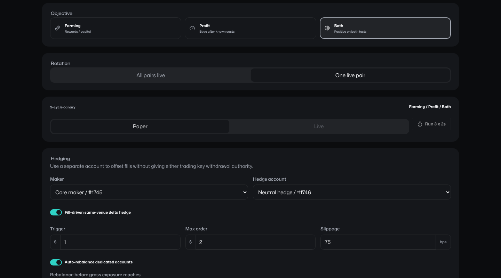

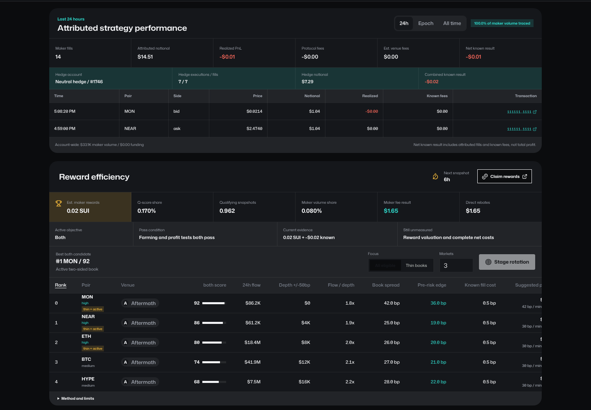

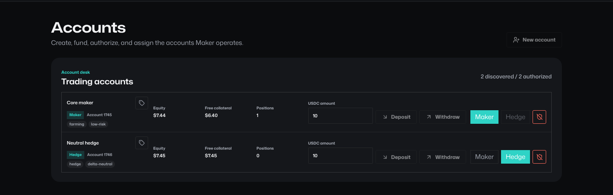

**Not yet on the theme:**

- **Performance:** hairline cells, teal and gold bands, a Rank column that starts at 0, "-$0.00", and a table clipped at the right edge.
- **Accounts:** bordered rows and filled role buttons.
- **Markets table:** 11 px headers on a tinted band.
- **Strategy:** the "Maker path" box and the 9 to 11 px labels inside it.
- **The Venue fee inspector:** a white-bordered box with a red band.
- **The onboarding card:** an inverted black card.
- **The footer:** slash-joined text ("Maker / wallet-gated public release / …").
- **The control log:** times clipped to "5:08 PN".
- **The phone dock:** see-through enough that card text shows behind "Flatten".

**Token fixes.** These are already applied in the v3 mockups, where my scan found no failures across 7 pages in either theme.

| Token | Was | Now | Result |
| --- | --- | --- | --- |
| Graphite 3, light | `#8A909B` | `#676C77` | 5.3:1 on white, 4.7:1 on the canvas |
| Graphite 3, dark | `#747A85` | `#8E94A0` | 5.9:1 on a card, 5.0:1 on a raised surface |
| Stop fill, both themes (new `--stop`) | Ember | `#D83427` | White text at 4.7:1. Ember stays for marks only |
| Text on Tide | white | never | Selected chips and roles use graphite fill or Tide-soft with ink text |
| Amber meter, light (new `--amber-bar`) | `#E8A200` | `#B27A00` | 3.7:1 against white, enough for a graphic |
| Live pill text | Ember text | Ink | The dot carries the colour, and the word stays readable on any background |
| Selected segment, dark | raised fill only | raised fill plus a 1 px light ring | The selected state shows against the track |

**Rules for one theme:**

- A 12 px floor everywhere, not just on the phone.
- Components take colours only from tokens.
- The three legacy surfaces are rebuilt from the shared components; they are not restyled in place.
- The open branch's contrast harness fails the build on any text under 4.5:1 or under 12 px, in every view and both themes.

## Bundles

A bundle is a maker account, a taker account, one strategy and its own engine loop. The wallet keeps one trading key, one gas reserve, wallet-wide limits and one Stop all across every bundle.

The UI calls the hedge account the **taker account**, matching your term. The code can keep `hedge`.

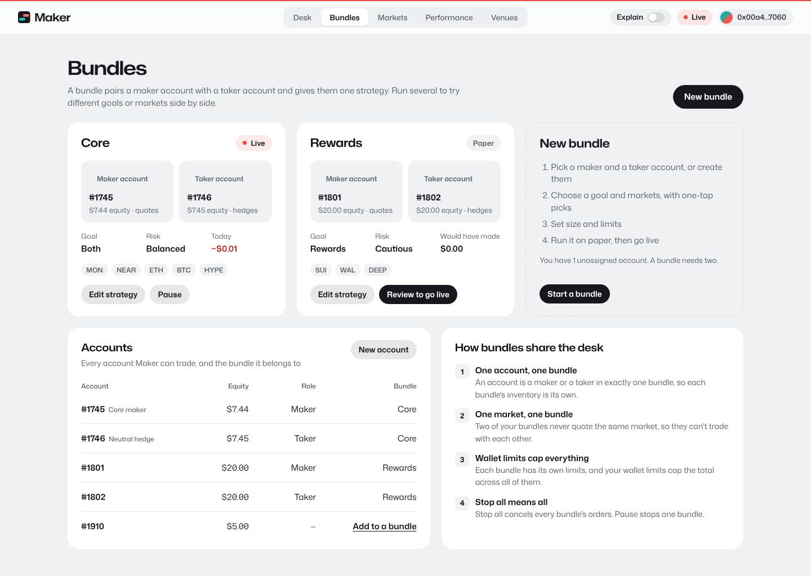

**What already supports it:**

- The gateway already queues every transaction per signing address, with cancels and Stop first. Bundles that share one trading key will queue safely behind each other.
- Each account is already set up and authorized on its own, so one trading key can trade many accounts.
- Hedge records already store both the maker and the hedge account IDs.

**What changes:**

| Area | Today | With bundles |
| --- | --- | --- |
| Strategy storage | One `config` setting per wallet | A `bundles` table with id, name, maker account, taker account, config, mode, status and timestamps. Today's config becomes a bundle named "Core" |
| Engine | `RuntimeManager` keeps one `MakerRuntime` per wallet | One runtime per wallet and bundle, all sharing the gateway |
| Records | Executions and maker orders keyed by wallet | Add a `bundle_id` so fills, volume and P&L can be counted per bundle |
| Limits | One set, from the config | Bundle limits, plus wallet limits on the total gross exposure, worst-case inventory and drawdown across bundles. A quote that would cross a wallet limit isn't sent |
| Stop | `stopTenant` stops the one runtime | Stop all stops every bundle and is never blocked by a busy one. Pause stops one bundle |
| Gas | One reserve | Still one reserve, sized to cancel every bundle's resting orders |
| API | `/api/config` | `/api/bundles` (list and create), `/api/bundles/:id/config`, `/:id/start`, `/:id/pause`, and `?bundle=` on performance and events. `/api/config` maps to Core during migration |
| Trial (canary) | Per config | Per bundle |

**Rules the schema enforces:**

1. **One account, one bundle.** Each account is a maker or a taker in at most one bundle, so each bundle's inventory belongs to it alone.
2. **One market, one bundle.** A venue market is quoted by at most one bundle, so your own accounts never trade with each other.
3. **Maker and taker differ.** This is already enforced today.
4. **Bundle limits fit inside wallet limits.** No bundle limit may exceed its wallet limit.
5. **A cap on bundles.** Four per wallet to start, to keep gas and signing load bounded.
6. **Live is gated twice.** It needs the server's existing live gates and that bundle's own Go-Live review.

**Rollout, each step gated:**

1. **B0 (RFC).** The agent writes the migration and API spec, then stops for your approval.
2. **B1.** The data and API changes, with exactly one bundle. Tests prove the orders are byte-identical to today's.
3. **B2.** Several bundles, in Observe and Paper only.
4. **B3.** Live bundles, only after an independent retest of the runtime changes alongside AM-EXT-01 to 06.

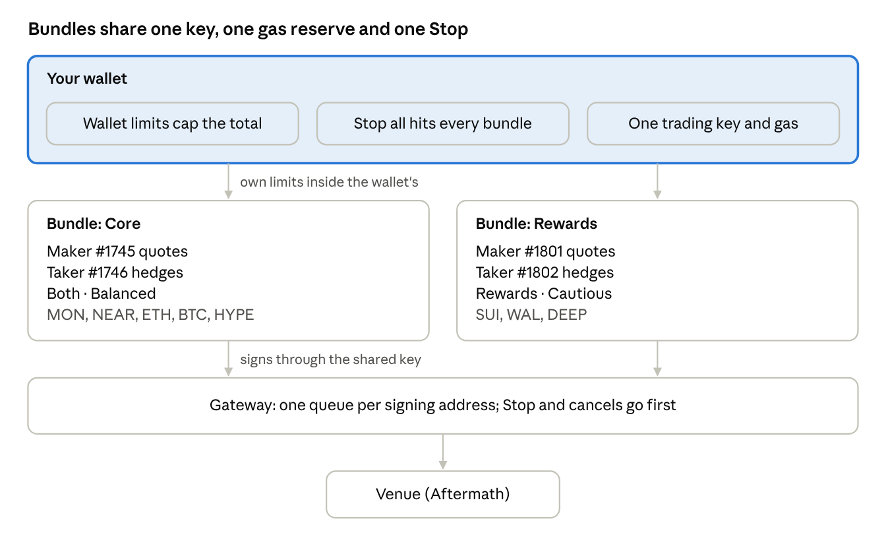

Each bundle keeps its own accounts, markets and limits. Everything that touches the chain goes through one key and one queue, so Stop all always goes first.

## Learning built in

The app teaches as it runs. Every screen tells you what is happening in a sentence, every term has a plain definition one tap away, and an Explain switch walks you through the view you're on.

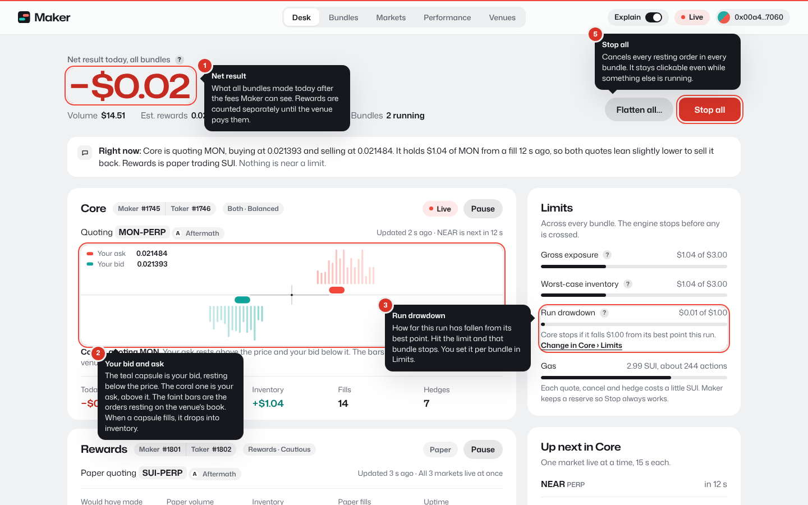

**Five layers, from always-on to on-demand:**

1. **A "Right now" sentence** at the top of the desk. It is built from templates and live data, not generated text.
2. **A caption under each live element.** Each bundle's market strip says what the last event meant, and statuses are plain words: "Quoting now", "Up next, 12 s" and "Waiting its turn".
3. **A ? on every term.** One glossary file (`lib/glossary.ts`) feeds the tooltips, the Explain notes and the Learn page, so the wording never drifts. It covers spread, bps, inventory, skew, hedge, unrealized P&L, run drawdown, Q-score, reward potential, maker, taker, Observe and Paper.
4. **An Explain switch** in the nav. It places up to five numbered notes on the current view. A first-run tour turns it on once by itself.
5. **A Learn page,** "Watch a market being made". It uses the same animation with five short chapters, and it is linked from the landing page, the empty desk and every ? popover.

**Templates for the "Right now" sentence.** If a value is missing, that clause is dropped, never guessed.

| Situation | Sentence |
| --- | --- |
| Quoting, flat | Core is quoting MON, buying at 0.021393 and selling at 0.021484, 42 bps apart. |
| Holding inventory | It holds $1.04 of MON from a fill 12 s ago, so both quotes lean lower to sell it back. |
| Hedge fired | Inventory passed $1.00, so the taker account sold $1.04 of MON at market. |
| Rotating | MON has 3 s left. NEAR is next. |
| Near a limit | Core is at $2.08 of its $2.50 inventory limit, so it is only quoting the side that reduces it. |
| Paused or stopped | Rewards is paused. Its orders are cancelled and it holds nothing. |
| Paper | Rewards is paper trading. Nothing it shows is a real order. |

## Screens

The nav becomes Desk, Bundles, Markets, Performance and Venues. Strategy moves inside each bundle, and Accounts folds into Bundles. Every screen below is a rendered mockup built only from the corrected tokens. Figures come from the repo's fixtures, and the second bundle is illustrative.

### Landing

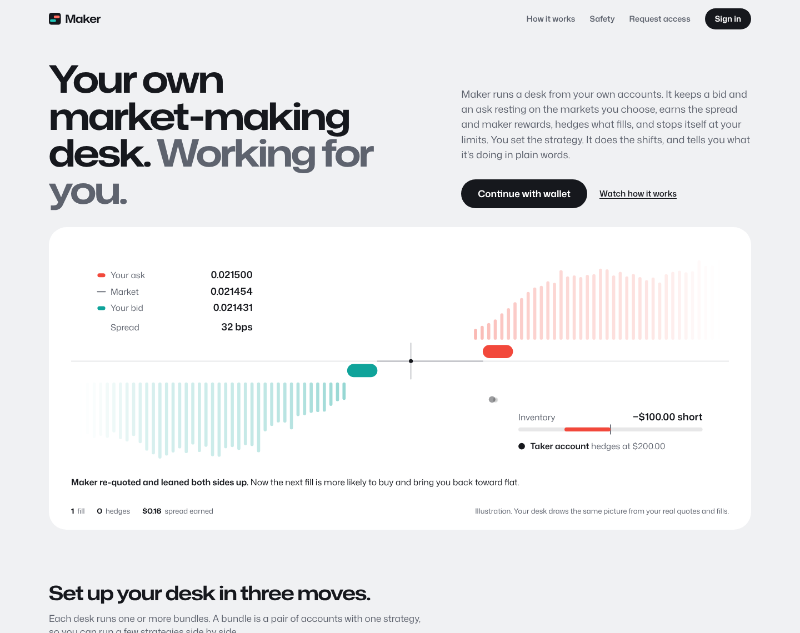

- The headline is about the desk working for you.
- The full-width animation shows the mechanism, labelled as an illustration.
- Setup is three moves: pair two accounts, pick a goal and markets, go Paper then Live.
- "While you're away" covers quoting, hedging, limits and Explain.
- Aftermath is named once, at the foot.

### Desk

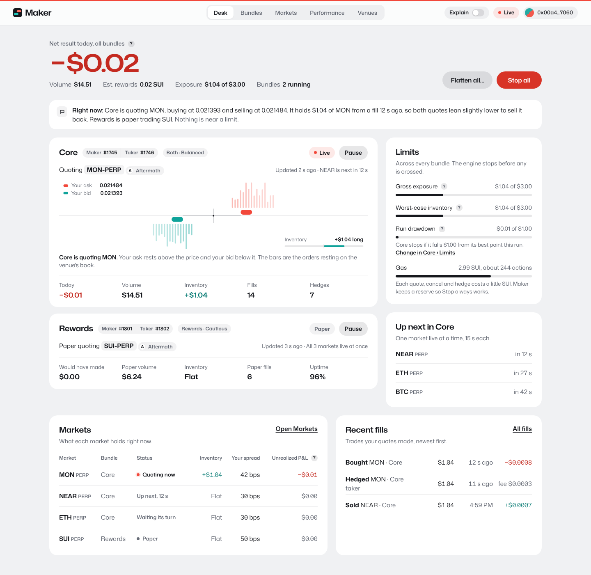

- **The hero:** net result across bundles at 2 decimals, with the exact figure in a tooltip, then volume, estimated rewards, exposure against its limit, and bundles running.
- **One lane per bundle:** its account pair, goal, mode, current market, the live strip with its caption, and today's figures. Each lane has its own Pause.
- **Limits:** every row has a ?, and run drawdown shows its real value, says what it does, and links to that bundle's Limits.
- **Markets:** column headers, including "Unrealized P&L ?", and status in plain words.
- **Fills:** read as "Bought", "Sold" or "Hedged", with the bundle named.
- **Data fix:** the engine already works out run drawdown every cycle. Return it in the risk snapshot rather than showing "Not reported".

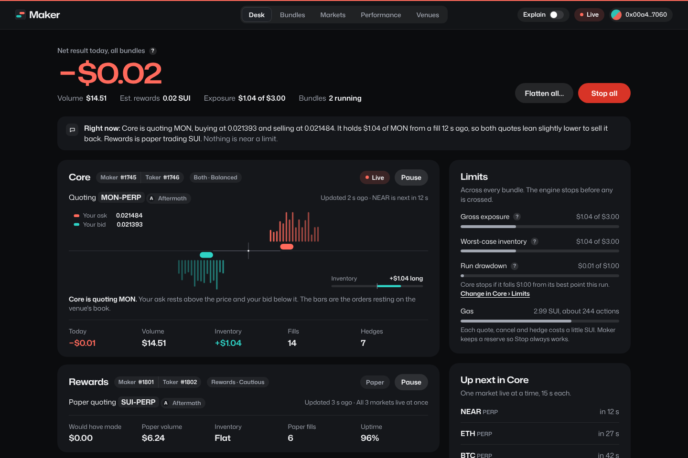

### Strategy, inside a bundle

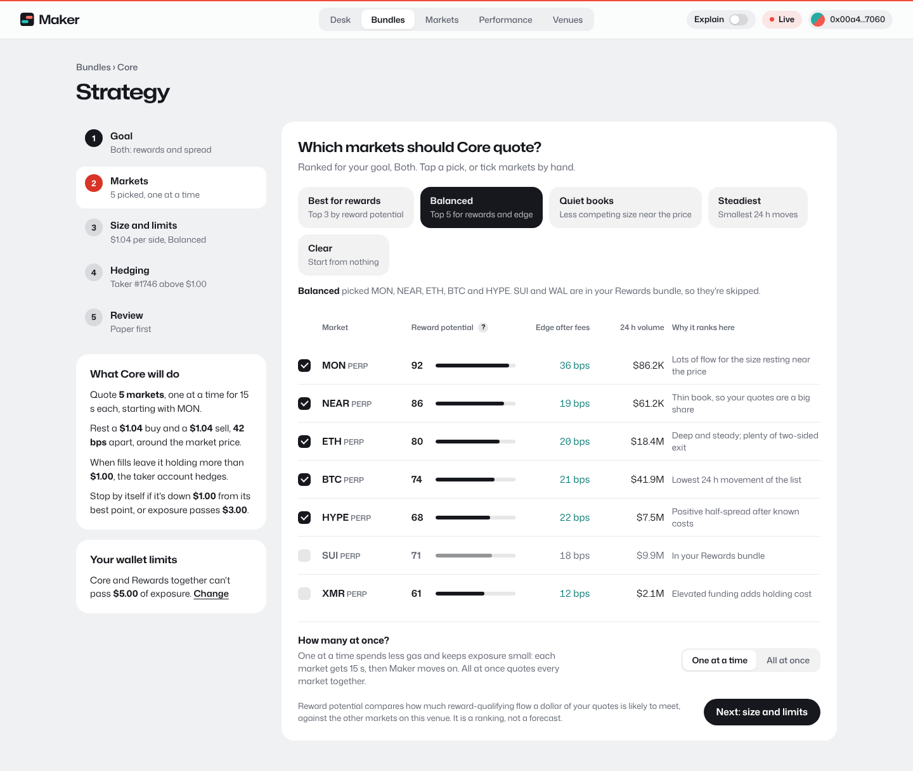

- **Five steps:** Goal, Markets, Size and limits, Hedging, Review. Each shows its current answer in the step list.
- **Quick picks:**
    - **Best for rewards:** the top 3 by the farming score.
    - **Balanced:** the top 5 by the "both" score.
    - **Quiet books:** thin books that still qualify.
    - **Steadiest:** the lowest 24 h moves.
    - **Clear.**
- **The scores already exist.** Every pick reads `rankRewardMarkets()`. Markets in another bundle are greyed and say which bundle has them.
- **Market rows** show reward potential as a 0 to 100 bar, edge after fees, 24 h volume, and the first reason from the ranking.
- **A live "What Core will do" summary** turns the settings into sentences as you change them.

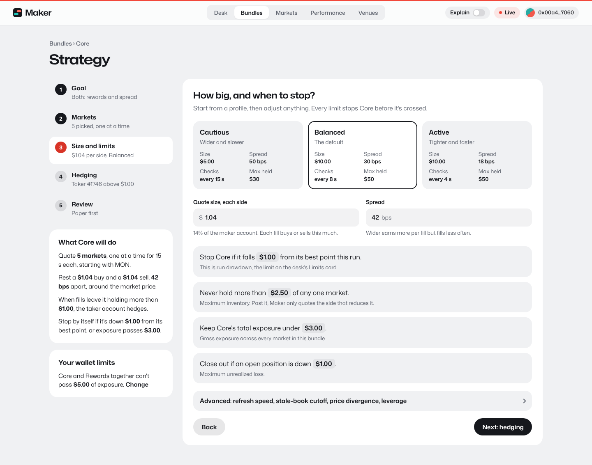

### Performance

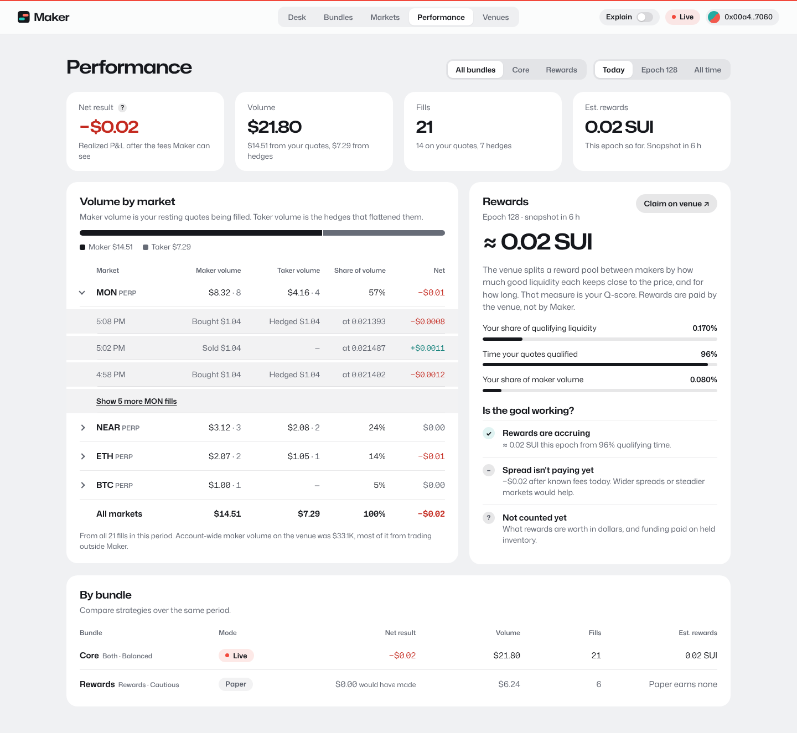

- **Four headline figures:** net result, volume (maker plus taker), fills and estimated rewards, filtered by bundle and by Today, Epoch or All time.
- **Volume by market:** maker volume and taker volume, each with fill counts, share of volume and net. A row expands to its fills.
    - It's built from the fills the server already returns. For speed, add a `volumeByMarket` total to the response.
    - If the server reports incomplete history (more than 10,000 fills), the table says how many fills it covers.
- **Rewards in plain words:** what the pool is, what a Q-score is, and three bars for your share of qualifying liquidity, time qualified and share of maker volume.
- **"Is the goal working?"** answers in checks, and it replaces "Pass condition / Current evidence / Still unmeasured".
- **"By bundle"** compares strategies over the same period.

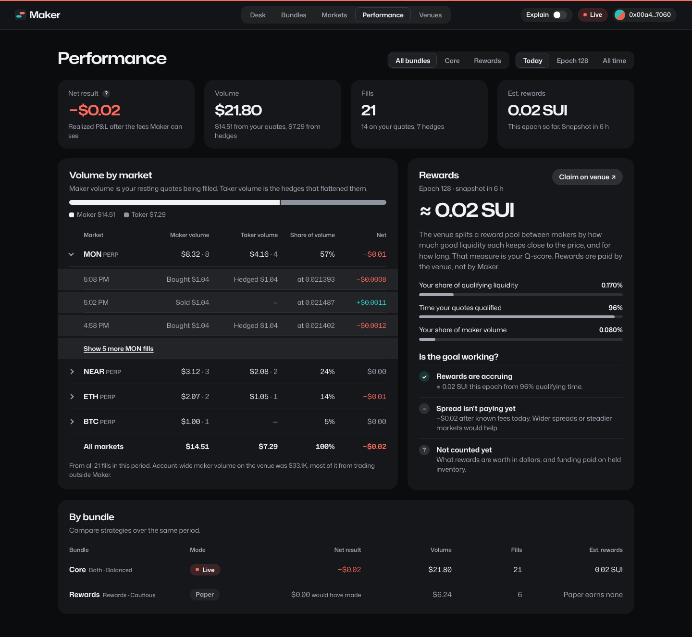

### Phone

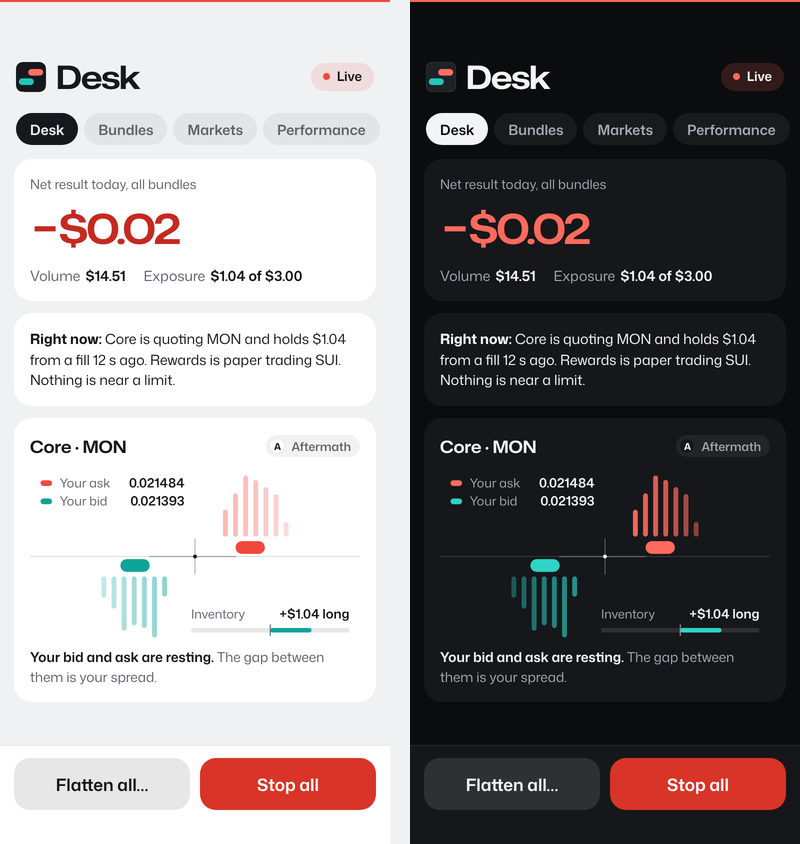

- The phone keeps the large title, the pill tabs, the "Right now" sentence and one live strip at a phone-sized scale.
- The dock is opaque, so content never shows through behind Flatten all or Stop all.

## The mark

The two-capsule mark stays, redrawn. Your ask sits a step above your bid on an ink tile, and the gap between them is the spread. It is the middle of the order book the animation draws, and the animation opens on it. The full study is on the Mark canvas (https://claude.ai/artifact/W2JEsep63Vsiow4DXidLff).

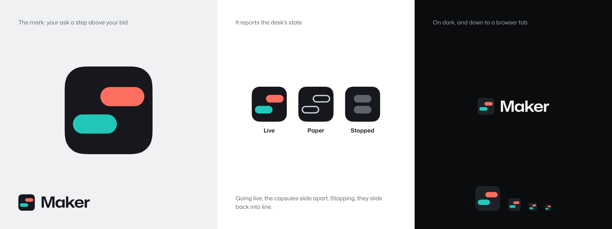

- **Grid:** 16 units. Capsules are 8 × 3.5 with a 1.5 spread gap and a 3 unit overlap, so the step runs exactly 45 degrees and sits centred on the tile.
- **Tile:** continuous corners, the same curve as a home-screen icon. In dark mode it lifts to `#1E2126` and takes a 1 px hairline.
- **Colour:** Ember `#FF6F61` and Tide `#22C7BA`, tuned for the ink tile so neither side shouts over the other.
- **States:**
    - Live is in colour.
    - Paper draws the capsules as outlines.
    - Stopped lines them up in grey.
    - Going live, the capsules slide apart. The favicon swaps with the state.
- **Small cut:** at 20 px and below, fuller capsules (8 × 4) on whole pixels.
- **Lockup:** the tile at 1.08 em, a 0.38 em gap, then "Maker" in Mona Sans 640 at 118% width.

## Motion: the market being made

One animation carries the product. It opens on the mark, and the two capsules part to their prices as the order book grows in around them: asks rising above the price on the right, bids hanging below it on the left. Sellers come down to hit bids and buyers come up to lift asks. A filled order folds into a dot that drops into inventory, Maker re-quotes with skew, and past the trigger the taker account sends a market order into the book. Each event is narrated in a sentence.

The live preview (https://claude.ai/artifact/PiAHiooVUVU9AhxevNU5yA, or `mockups/learn.html`) runs it. The same component drives the landing page, each desk lane and the Learn page.

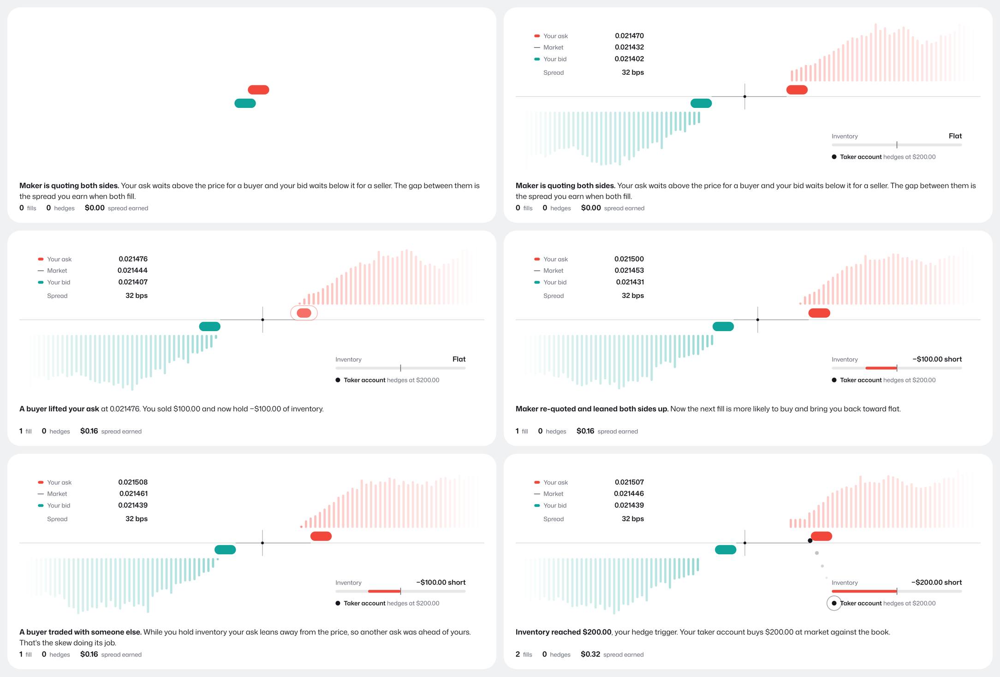

| Event | What moves | Time | Source in the app |
| --- | --- | --- | --- |
| Opening | The mark appears and holds, then the capsules part while the price line draws out and the book grows from the middle | About 1.6 s, once per view | Your bid and ask |
| Price moves | The book slides under a camera that follows the price | Settles in about 1 s | Index price from the snapshot, interpolated between polls |
| Requote | Your capsules glide to their new prices, without overshoot | About 300 ms | Your new bid and ask |
| Fill | The taker's dot lands on your capsule, the capsule folds into a dot, and the dot drops into the inventory meter. A new order grows back at the new price | 0.6 s in, 0.25 s fold, 0.8 s drop | A new attributed fill since the last poll |
| Skew | Both capsules shift together, and the caption says why | With the requote | Your quotes relative to the price, plus inventory |
| Hedge | A dot leaves the taker account and takes from the front of the book, and the meter returns to zero | 0.9 s | A new hedge execution |
| Someone else trades | The front bar of the book flashes and shrinks, then refills | 2.6 s recovery | Illustration only |
| Mode change | The mark's capsules slide apart or back into line | 240 ms | Mode and running state |

**Rules:**

- **The desk shows only real data.**
    - Arriving takers, sweeps and "someone else traded" exist only on the landing and Learn pages, labelled Illustration. The venue gives no trade feed, so the desk never invents one.
    - The desk draws the venue's real book from a new read-only field, `snapshot.market.book`. It holds up to 50 levels per side, taken from the order book the runtime already fetches each cycle, and it feeds no trading decision.
    - Until that field lands, or for a cycle without a fresh book, the desk draws only the venue's best bid and ask, one bar each. It never draws an illustrative book.
- **Reduced motion** shows one settled still frame and its caption, with no loop.
- **The animation pauses** when its lane scrolls off screen or the tab is hidden.
- **One moving thing per card.** Nothing else on the page animates while it plays.
- **Build:**
    - Write `components/market-motion.tsx`, ported from `mockups/motion.js` in the handoff.
    - Draw plain SVG, with no animation library.
    - It exposes `update()`, `fill(side)` and `hedge()` for real data.

## Security

The security items for this round are briefed to the implementing agent directly. This copy is in a public repo, so it leaves them out.

## Plan and handoff

The web work can start now and needs no trading change. Bundles come after it, behind two gates: your approval of the RFC, and an independent retest before any bundle goes live.

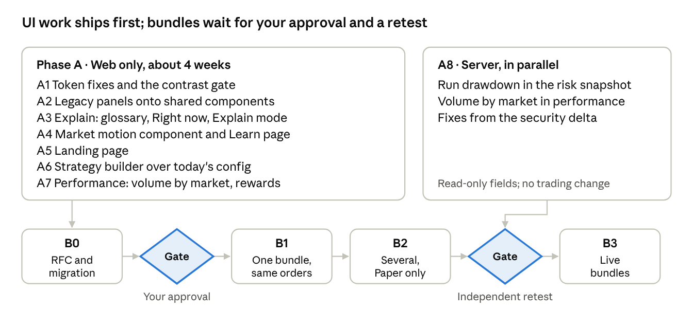

Phase A is about four weeks for one agent. The steps are ordered so the biggest complaints (contrast, theme and "I don't understand") are fixed first. Each step is one commit that passes `npm run check`, keeps `npm audit --omit=dev` at 0, and passes the contrast gate in both themes.

The agent stops after B0 and waits for you.

**Unchanged constraints:**

- Live gates stay off.
- Nothing is signed or broadcast.
- No production API calls and no deploys.
- The remediation fixes and security headers stay as they are.
- Stop is never disabled while anything runs.

Phase A's server work is limited to three read-only fields and the security fixes, each with tests.
