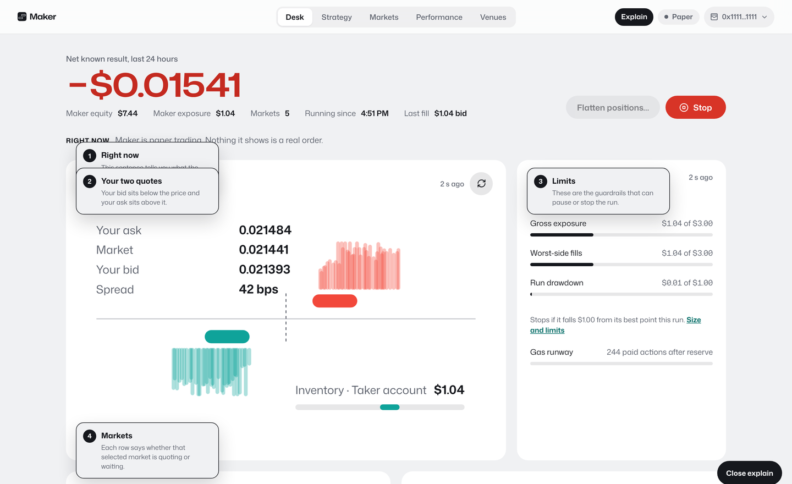
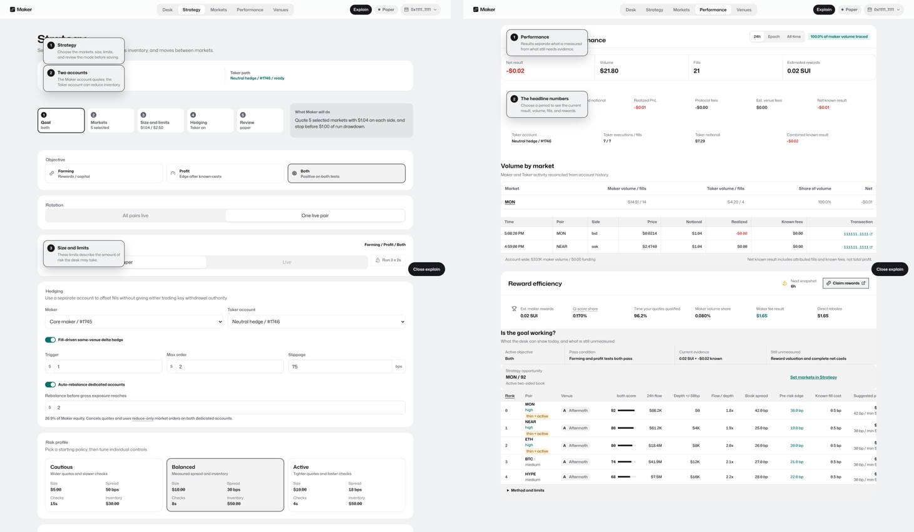
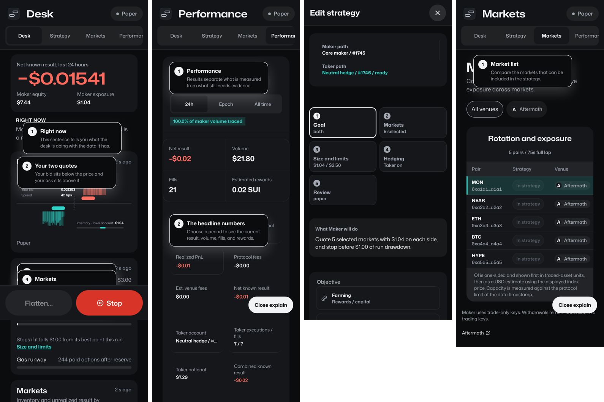
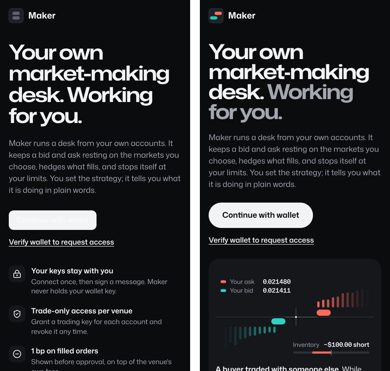
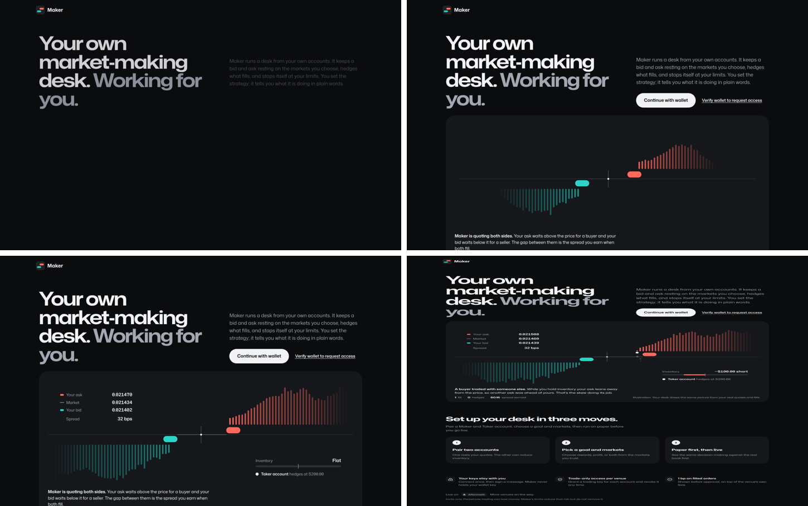
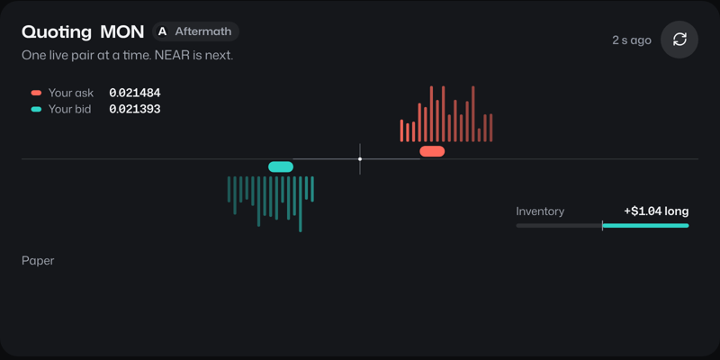

# Review of v3.1 as merged

Reviewed on Oct 28, 2026. The base was `main` at `77e4df2`, a local production build run against the repo's fixtures, at 1440 and 390 px, in light and dark.

The PR `fix/connect-button-and-motion` already fixes two of these problems: the connect button and the animation. Everything else here is open, and section 3 of `AGENT_INSTRUCTIONS.md` turns it into steps.

## Step by step

| Step | Status | What's missing |
| --- | --- | --- |
| A1 Contrast gate | Partly done | The audit couldn't see inside dapp-kit's shadow root, so the unreadable dark connect button passed. It also skipped SVG text. Both are fixed in the PR. |
| A1b Mark | Done | The landing used the grey stopped mark (fixed in the PR). The favicon uses 7.2 × 2.7 capsules instead of the 8 × 4 small cut. |
| A2 Legacy surfaces | Partly done | The control log clips the time ("5:08 PN"). Performance shows "−$0.00" and clips at the right edge. Status words truncate ("Waiting its…"). |
| A3 Explain | Partly done | Notes stack on each other and cover their targets at 1440 and at 390. The first-run tour turns Explain on, so every new user sees the overlap. |
| A4 Motion and Learn | Not done | The component was a static rewrite: a seeded book, a one-second grow-in, and no choreography or phone layout. The PR replaces it with the real engine. Learn chapters still barely touch the animation. |
| A5 Landing | Partly done | The picture didn't move (fixed in the PR). The rest of `landing.html` is missing: nav, "While you're away", the trust row placement, the final call to action and the mini demos. |
| A6 Strategy builder | Not done | The five tiles sit above the whole old form instead of replacing it. Limits aren't sentences. Mode sits under Capital, not Review. Stage rotation and the rank table are still on Performance. |
| A7 Performance v3 | Partly done | Every fill shows under the first market. Ranks start at 0. Fees read "−$0.00". The rank table clips. "Is the goal working?" kept the old three columns. |
| A8 Read-only fields | Done | Nothing. |
| S1 to S5 | Done | Nothing in the repo. |
| B0 RFC | Done | Four owner decisions, answered in section 3B of the instructions. |

## Desk

- Explain notes 1 and 2 overlap and hide the "Right now" sentence. Note 4 covers the Markets heading.
- The hero shows "−$0.01541". It should show 2 decimals, with the exact value in a tooltip.
- Status and side words truncate: "Quoting n…", "Waiting its…", "Boug…".
- The control log clips the time: "5:08 PN".
- The market lane leaves about 100 px empty under the animation on desktop.

## Strategy and Performance

- **Strategy:** the step tiles are a summary over the full old form. The builder never steps.
- **Performance:** NEAR's fill is listed under MON. Ranks start at 0. The last column clips. The rank table belongs in Strategy › Markets.

## Phone

- Explain notes cover headings on every view.
- `shots.mjs` fails its own 44 px tap-target check on Desk ("Size and limits", 18 px tall), Markets ("In strategy", 30 px) and Performance ("Set markets in Strategy", "MON").
- The sticky Flatten and Stop bar covers content.
- The tab bar cuts "Performance" off with no sign that it scrolls.
- Performance tables clip instead of scrolling inside their own container.

## Fixed in the PR

## Tooling

- `test/format.test.ts` passes only when `TZ=UTC`, so `npm run check` fails on machines in other time zones.
- `prettier --check .` failed on main because of the vendored handoff bundles. The PR adds `docs/design/` to `.prettierignore`.
- `shots.mjs --state signed-out --view all` times out; signed-out has no views.
- The report listed screenshots under `/tmp`, so nobody could review them from the repo. This round's report commits them (section 7).
