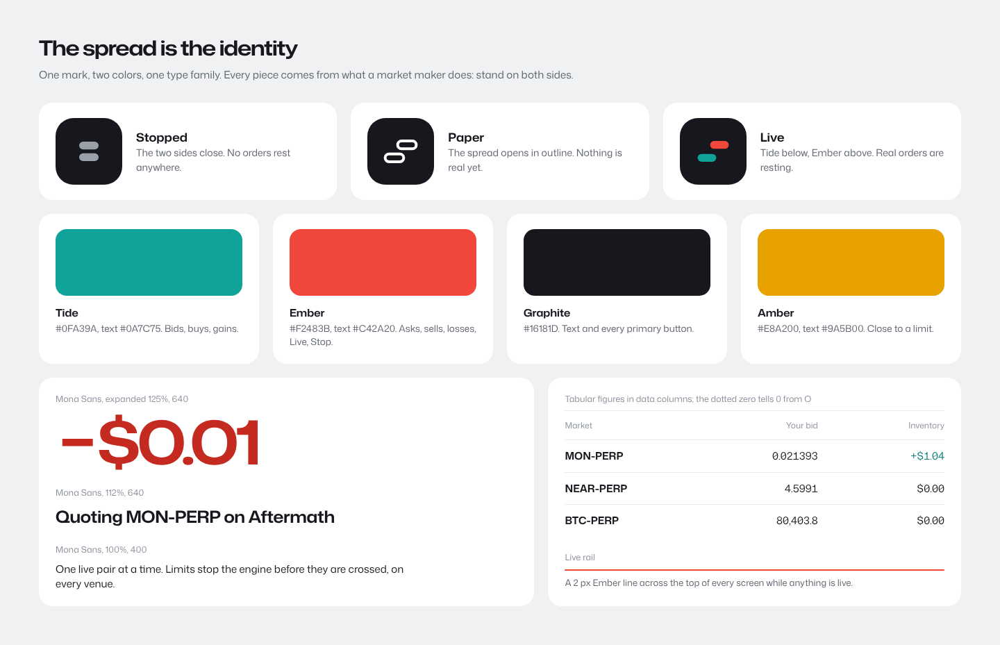
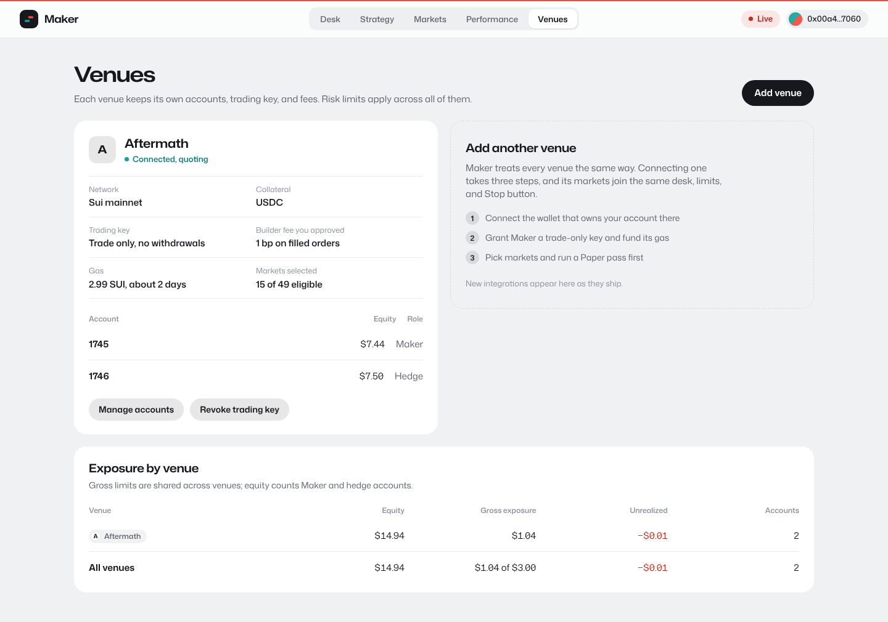
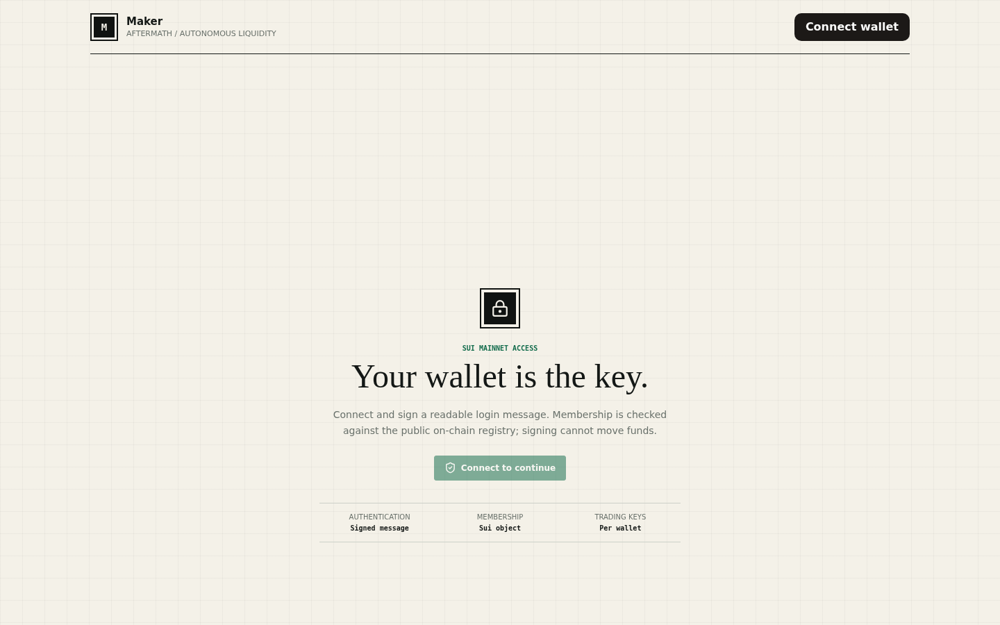
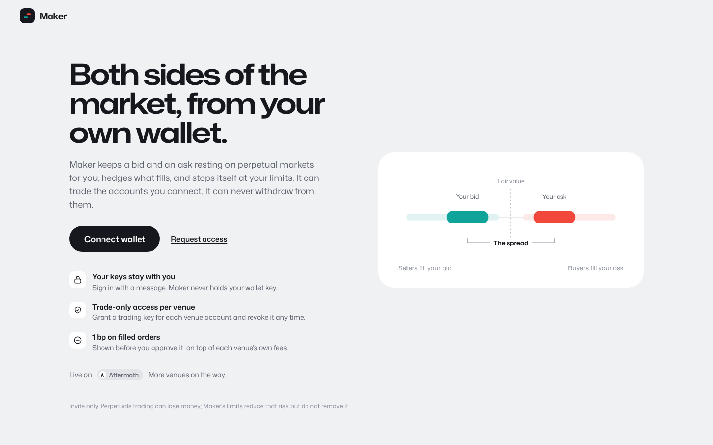
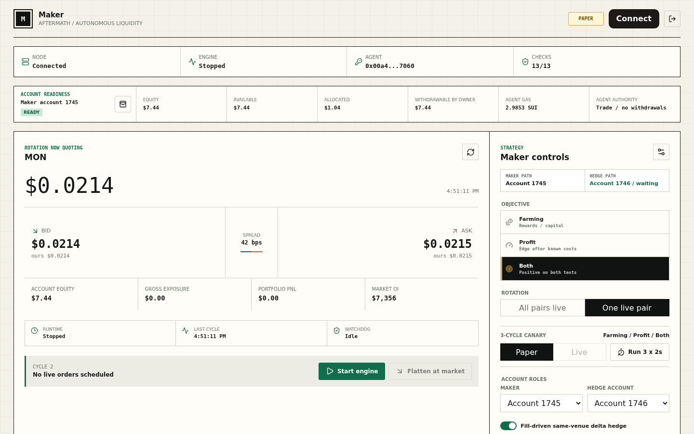
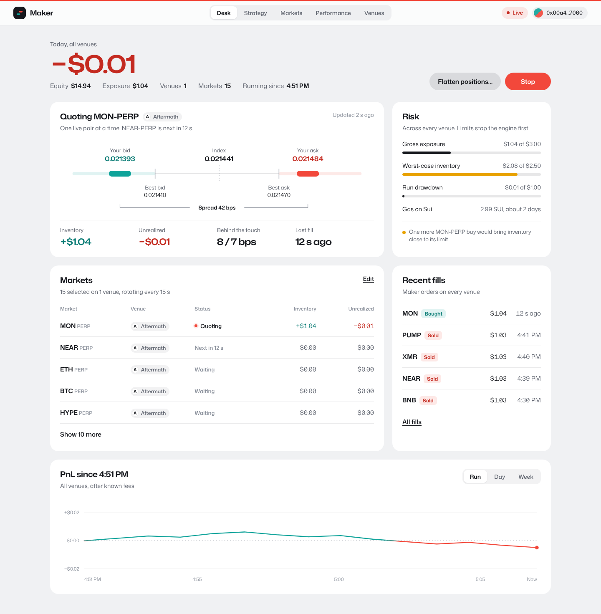
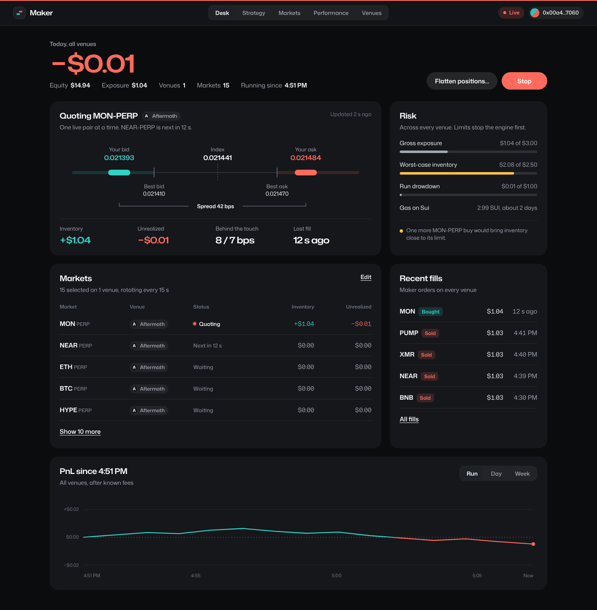
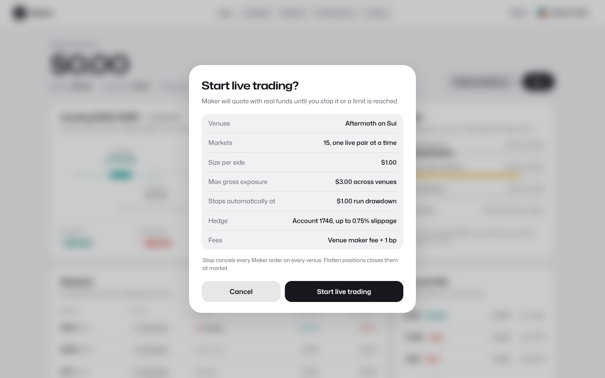
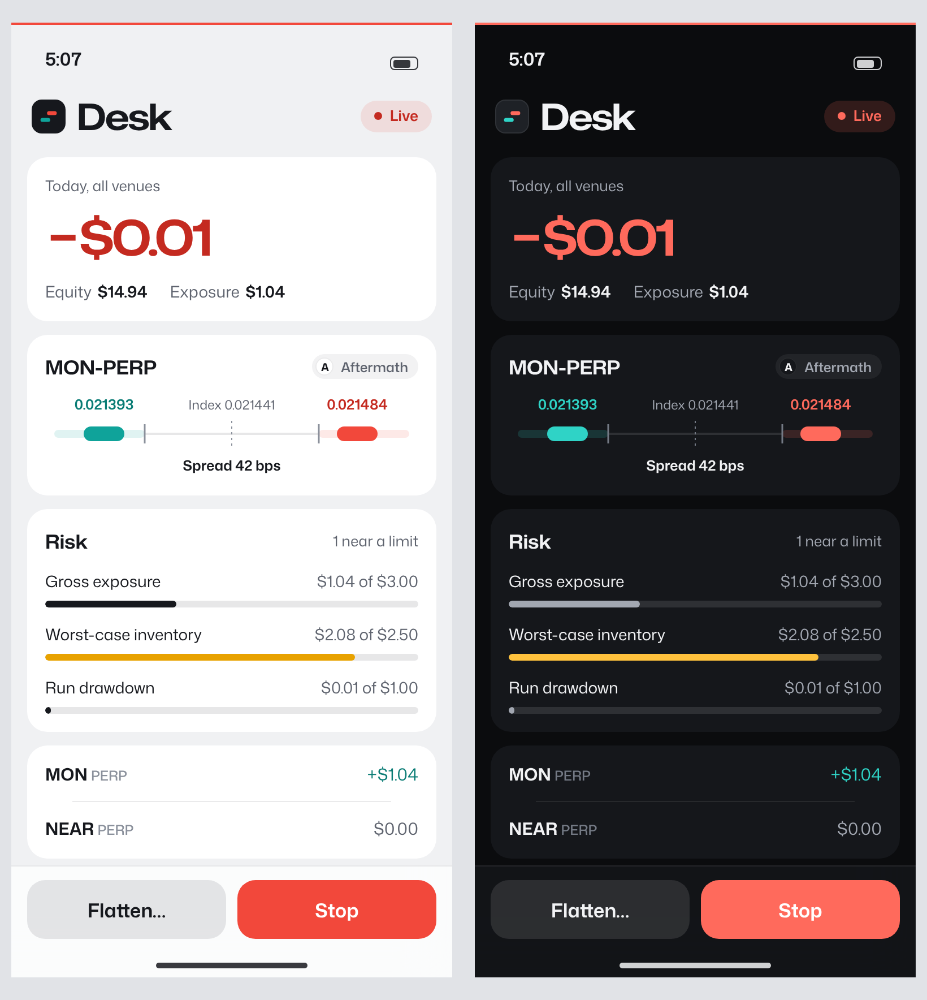

# Maker — Visual Polish Audit

Oct 27, 2026 · @zoz

> Primary reference for look, brand, tokens, copy, and venue neutrality. Where this document and `02-ux-design-review.md` disagree on visual identity, this document wins.

## Summary

Maker should feel as calm as Apple software but look like nothing else: its identity is the spread itself, and every screen treats Aftermath as one venue among several to come.

Today's look reads as AI-generated because it uses the default kit: cream paper (`#f4f1e8`) with a grid, a Georgia serif headline, a clay-coral accent (`#d95a3b`), tinted near-black, uppercase eyebrows over every panel, and monospace for small numbers.

The first pass of this audit fixed that with a near-copy of Apple: system type, system blue, light grey canvas. It was clean but not Maker's. This revision keeps the calm and adds four owned pieces, all taken from what a market maker does:

1. **The spread mark.** An ask capsule above a bid capsule. It closes when stopped, opens in outline in Paper, and fills with color when Live, so the logo reports state.
2. **Tide and Ember.** The brand's two colors are its two sides: teal for bids, buys, and gains, red-orange for asks, sells, losses, and Live. Everything else is graphite.
3. **One family, two widths.** Mona Sans at normal width for the interface and expanded width for money, so the numbers have a voice SF Pro does not.
4. **The Live rail.** A 2 px Ember line across the top of every screen while anything is live.

Venue neutrality runs through all of it: venues are a first-class tab, every market and fill carries a venue chip, risk and PnL roll up across venues, and no Aftermath name or color appears in Maker's own brand.

## What reads as generic today

Nine tells account for most of the "generated" feel; each has a direct replacement.

| Tell | Where it shows in Maker | Replace with |
| --- | --- | --- |
| Cream paper and graph-paper grid | `--paper: #f4f1e8` plus a 32 px grid on `body` | Cool mist canvas `#F0F1F3`, white cards, no grid |
| Serif display headline | "Your wallet is the key." in Georgia | Mona Sans expanded, semibold |
| Clay-coral accent | `--coral: #d95a3b` on asks, errors, the flatten banner | Ember `#F2483B`, used only for asks, losses, Live, and Stop |
| Tinted near-black bands | `--black: #101311`, black setup and operator bands | Graphite `#16181D` for text and primary buttons; dark surfaces only in dark mode |
| Uppercase tracked eyebrows | ROTATION NOW QUOTING, STRATEGY, MARKET BOOK, PREFLIGHT, EVIDENCE; 33 uppercase rules in the stylesheet | One sentence-case title per card; no label above it |
| Monospace for small data | `ui-monospace` in 68 places: values, IDs, the log | Mona Sans tabular figures in data columns; monospace only for digests |
| Hairline boxes everywhere | 1 px black frames around every panel and cell | No borders; cards separated by surface color and spacing |
| Square corners | Only four rules set any radius, at 2–3 px | 12 px controls, 20 px cards, 30 px sheets, full pills |
| Slash-joined meta strings | "AFTERMATH / AUTONOMOUS LIQUIDITY", the footer line | Say one thing plainly, or nothing; never name a venue in Maker's brand |

The palette and type do most of the damage. Fixing tokens alone, before any layout change, removes roughly half the generic feel.

## Direction: the spread is the identity

The calm comes from Apple; the character comes from the one picture every market maker understands, a bid and an ask with a gap between them.

**What is owned.**

- **The mark reports state.** Stopped closes the two capsules, Paper opens them in outline, Live fills them with Tide and Ember. The nav, favicon, and phone header all use it, so a glance at a browser tab tells you whether money is at risk.
- **Two colors with one meaning each.** Tide is the bid side and Ember is the ask side, and that carries through: gains are Tide, losses are Ember, the PnL line changes color as it crosses zero. Graphite does everything else, including every primary button, so color never competes with data.
- **Width as hierarchy.** Mona Sans is open source, has a width axis, and has tabular figures. Expanded semibold is reserved for money and titles; normal width does the interface. One family keeps it quiet; the wide numerals make it recognizable.
- **The Live rail.** A thin Ember line pinned to the top edge whenever anything is live. It replaces banners and badges as the main Live signal.
- **Dotted zeros in data.** Mona Sans's tabular zero carries a dot, which tells 0 from O in prices and addresses. Use it in aligned columns; single figures use plain proportional digits.

**What stays from the Apple pass.** Hierarchy through size and weight rather than boxes, depth only where something floats, motion only in answer to an action, sentence-case words, and dark mode shipped with light.

## Venue-neutral by design

Aftermath is the first venue, not the brand: Maker's nouns are desk, market, and venue, and every screen should read the same with one venue or five.

- **Markets carry a venue chip.** Name markets by asset and contract (MON-PERP) and show the venue as a monochrome chip beside it, in the ladder, the markets list, and fills.
- **Venue colors never enter Maker.** Chips use a letter or glyph in graphite on a grey fill, so Tide and Ember keep their meaning however many venues join.
- **Totals roll up.** The hero, equity, exposure, risk meters, and PnL chart say "all venues". Each venue card owns its network, collateral, accounts, gas, and approved fee.
- **Stop means everywhere.** Stop and Flatten act on every venue at once; pausing one venue lives on its card.
- **Generic words.** "Trading key" instead of agent capability, "venue fee" instead of a venue's fee name, "gas on Sui" only where the network matters.
- **One onboarding path.** Add a venue: connect the wallet that owns the account there, grant a trade-only key and fund its gas, pick markets, run Paper. Every integration follows the same three steps.
- **The public page names Aftermath once.** "Live on Aftermath. More venues on the way." Nowhere else in Maker's brand.
- **Room for cross-venue later.** With a second venue, the hedge can sit elsewhere, the markets list groups by asset with a row per venue, and the ladder can show two books.

In code, the dashboard names Aftermath 17 times. Moving those strings behind a small venue descriptor (name, network, collateral, fee model, gas unit, account roles) keeps components venue-agnostic; the server already isolates the integration in `packages/aftermath`.

## Before and after

These are rendered HTML mockups using only the tokens in the next section. Figures come from the audit screenshots; the PnL curve and the second account's equity are illustrative. Source is in `../mockups/`.

### Sign-in

Before: cream grid, serif headline, a pale button that reads as disabled, and nothing about what Maker does.

After: the headline says what Maker is without naming a venue, and the right side shows the product's core picture, your bid and ask around fair value. One graphite button, a Request access link, three trust facts, and Aftermath named once as the first venue.

### Desk

Before: the market price is the hero, controls are split across panels, and every block has the same black frame.

After: today's PnL across all venues leads in expanded numerals, the Live rail and lit mark show state, and Stop sits top right. The ladder's filled capsules repeat the mark, risk meters stay graphite until something nears a limit, and every market carries its venue chip.

The same desk in dark mode, from the same tokens:

### Going live

The review sheet lists venues first, then size, limits, hedge, and fees. The mark stays in its Paper outline behind it until you confirm.

### Phone

A monitor and kill switch: the lit mark beside the large title, PnL across venues, the ladder with its venue chip, risk, and Stop pinned above the home indicator.

## Visual system

Twelve color tokens, eight type roles in one family, and a short set of shape and motion rules; every mockup above uses only these.

### Color

| Token | Light | Dark | Use |
| --- | --- | --- | --- |
| Canvas | `#F0F1F3` | `#0B0C0E` | Page background |
| Surface | `#FFFFFF` | `#15171B` | Cards |
| Raised | `#FFFFFF` + shadow | `#1E2126` | Sheets, menus |
| Graphite | `#16181D` | `#F2F3F5` | Text and every primary button |
| Graphite 2 | `#5E636E` | `#A2A7B1` | Supporting text |
| Graphite 3 | `#8A909B` | `#747A85` | Axes, placeholders, "Waiting" |
| Hairline | `rgba(22,24,29,.09)` | `rgba(255,255,255,.08)` | Row separators |
| Fill | `rgba(22,24,29,.055)`, strong `.10` | `rgba(255,255,255,.06)`, strong `.11` | Tracks, chips, quiet buttons, tab track |
| Tide | `#0FA39A` marks, `#0A7C75` text | `#2FD3C6` | Bids, buys, gains |
| Ember | `#F2483B` marks, `#C42A20` text | `#FF6A5C` | Asks, sells, losses, Live, Stop |
| Amber | `#E8A200` marks, `#9A5B00` text | `#FFC23D` | Within 30% of a limit |
| Material | `rgba(255,255,255,.74)` + 22 px blur | `rgba(21,23,27,.74)` + blur | Nav bar, phone dock |

On white, the Tide, Ember, and Amber text shades reach 5.0:1, 5.6:1, and 5.3:1, all above WCAG AA. In dark mode the single shades clear 6:1 on Surface.

### Type

Mona Sans everywhere, loaded with `next/font` from its open-source variable file. Width carries the hierarchy: 125% for money, 112–122% for titles, 100% for the interface.

| Role | Size / line | Width | Weight | Used for |
| --- | --- | --- | --- | --- |
| Hero money | 60 / 62 | 125% | 620 | Today's PnL |
| Page title | 34 / 38 | 122% | 640 | Tab titles; 32 on the phone |
| Stat | 22 / 28 | 125% | 620 | Inventory, unrealized, last fill |
| Card title | 19 / 24 | 112% | 640 | Card titles, market names |
| Body | 15 / 21 | 100% | 400 or 620 | Rows and values |
| Subhead | 14 / 20 | 100% | 400 | Card subtitles |
| Footnote | 13 / 18 | 100% | 520 | Labels, pills, timestamps |
| Caption | 12 / 16 | 100% | 560 | Table headers and axes; the floor |

Tracking is −0.02em at expanded widths and 0 at normal width. Figures are proportional by default and tabular, with the dotted zero, in aligned columns.

### Shape, depth, and motion

- **Spacing:** a 4 pt grid. Cards pad 22 by 24 px, grids gap 20 px, gutters are 40 px on desktop and 14 px on a phone.
- **Radius by role:** 9 px tab thumb, 12 px controls and tab track, 16 px grouped lists and phone buttons, 20 px cards, 30 px sheets, full pills. The mark's square is 30% of its size.
- **Depth:** cards are flat. The nav and dock use material with a 1 px hairline; sheets get `0 1px 1px rgba(16,18,22,.04), 0 16px 48px rgba(16,18,22,.12)` over a 22% scrim with a 10 px blur.
- **Signature motion:** the mark's capsules slide apart over 240 ms when Paper or Live starts and close when stopped. Ladder capsules glide to new prices over 200 ms, values cross-fade over 150 ms, and the Live rail fades in. Nothing else moves; reduced motion makes all of it instant.
- **Icons:** `lucide-react` at 1.75 stroke in graphite. No colored icons, so color stays meaningful.

### Numbers

- PnL always signed with a true minus (−), never Tide or Ember at zero.
- Dollars at two decimals from $1 up, four significant figures below; prices at the market's own tick.
- Relative time under a minute ("12 s ago"), clock time after.
- Monospace only for transaction digests and full addresses.

## Screen-by-screen polish

These details turn the tokens into finished screens; Strategy and Markets are not mocked yet, so their notes are the most specific.

### Sign-in

- One graphite call to action. Drop the header "Connect wallet".
- The wallet picker opens as a sheet and groups wallets by network as venues on other chains arrive.
- A non-member who signs lands on a calm "You're not on the list yet" screen with Request access, not a 403 banner.

### Desk

- Stop is Ember, filled, and always enabled while anything is live. Flatten positions is a quiet grey pill with an ellipsis because it opens a confirmation.
- State lives in three places only: the mark, the Live rail, and the mode pill. No Live banners.
- "Updated 2 s ago" in Graphite 3 on each live card turns Amber after two missed refreshes.
- When more than one venue is quoting, the ladder card gets a venue switcher in its header instead of a second card.

### Strategy

- Lay it out like a settings screen: grouped lists titled Capital, Risk profile, Markets, Hedging, and Advanced, with Advanced collapsed.
- Show Cautious, Balanced, and Active as three large cards, each listing the four or five values it sets.
- Group the market picker by venue, with a venue filter chip row above it.
- Put units inside fields ("$1.00 per side", "42 bps"), validate inline, and show a Discard and Save bar only when something changed.

### Markets

- The reward ranking moves here from the desk: one row per market per venue, a venue filter, and sort on any column.
- Rank bars use Graphite, not Tide, because rank is not a gain.

### Tables and lists

- No vertical rules or cell borders. Rows are 52 px with a hairline inset 24 px from both edges.
- Headers are 12 px sentence case in Graphite 3; numbers right-align with tabular figures.
- A Venue column appears wherever rows can come from more than one venue, even while there is only one.

### States

- **Empty:** one icon, one sentence, one button ("Pick markets to start", "Add a venue").
- **Loading:** skeleton bars in Fill; the mark's capsules pulse apart slowly in place of spinners.
- **Errors:** Ember text under the control that failed, naming the venue when one is involved, and saying what to do next. Confirmations use a material toast at the bottom center.
- **Mode:** Live is a lit mark, the rail, and an Ember pill; Paper is an outlined mark and a grey pill; Stopped is a closed mark and no pill.

### Phone

- The lit mark beside a large title, 18 px cards, and the Stop and Flatten dock above the home indicator.
- Strategy edits open as a full-height sheet with the same grouped lists.

### Brand details

- The favicon is the mark in its current state, so a background tab shows whether anything is live.
- Use the mark for the touch icon and social image; retitle the page "Maker" and drop "Aftermath / Autonomous liquidity" and the slash-joined footer.

## Implementation plan

About four weeks for one engineer; the first two steps alone remove the generic look and the Aftermath-only framing. Effort figures are estimates.

1. **Tokens, type, and mark, 2 days.** Replace the `:root` palette, delete the grid, load Mona Sans with `next/font`, set the proportional and tabular rules, and strip the 33 uppercase and 68 monospace rules. Build the spread mark as one SVG component with three states, and drive the favicon from it.
2. **Venue descriptor, 1–2 days.** Move the 17 hardcoded Aftermath strings in the dashboard behind a descriptor (name, network, collateral, fee model, gas unit, account roles), add the venue chip, and rename copy to trading key and venue fee.
3. **Primitives, 2–3 days.** Buttons, pills, tabs, inputs, toggle, card, list row, meter, sheet, and toast, each in light and dark.
4. **Shell, 2 days.** Frosted nav with Desk, Strategy, Markets, Performance, and Venues; the Live rail; the mode pill.
5. **Desk, 4–5 days.** Hero, ladder, risk meters, markets, fills, and chart. Stop becomes always enabled here, closing the design review's P0.
6. **Sign-in, Venues, and Go-Live sheet, 3 days.** All three are drawn above.
7. **Strategy and Markets, 4–5 days.** Grouped settings with profile cards, and the ranking table moved out of the desk.
8. **Phone, 3 days.** Large titles, stacked cards, and the Stop and Flatten dock.
9. **Finish, 2 days.** Reduced motion, focus rings, screen-reader labels on the ladder and meters, and a contrast pass in both themes.

The security fixes from the first audit are independent of this work and should not wait for it.
