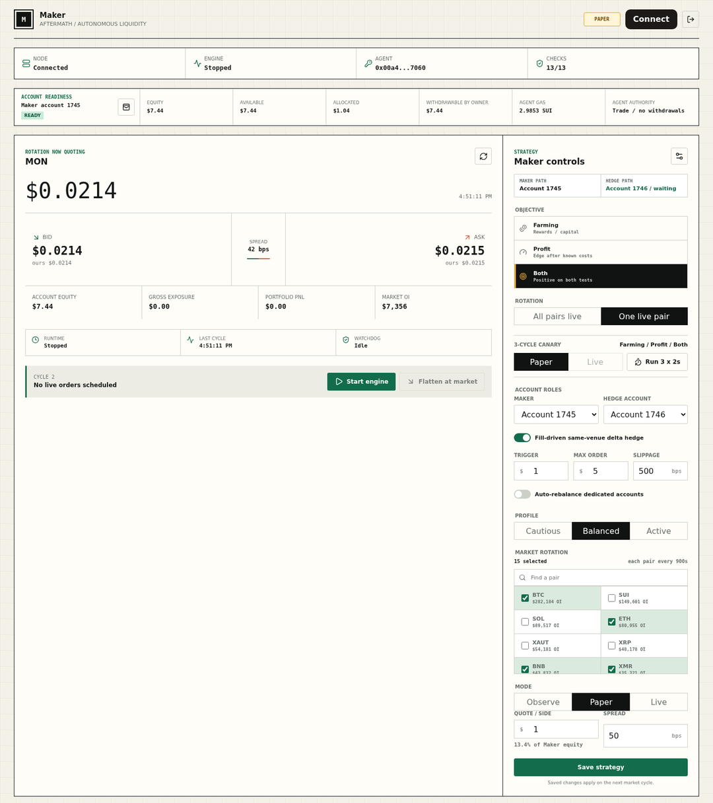
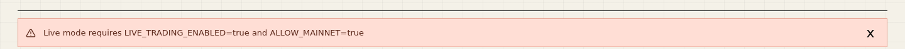
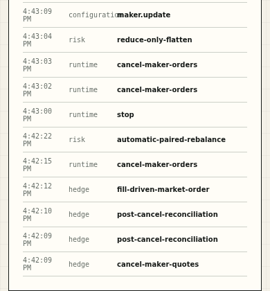
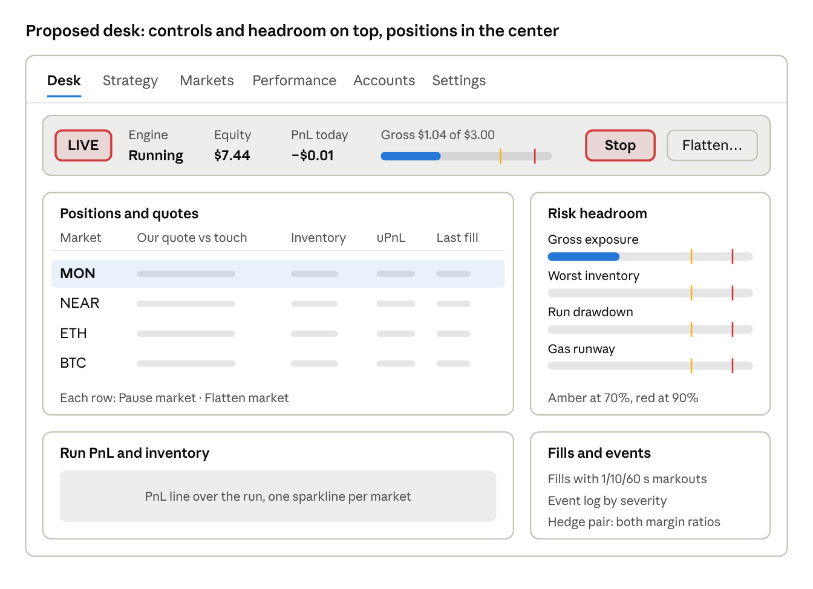

# Maker — UI/UX Design Review

Oct 27, 2026 · @zoz

> **Read this with `01-visual-polish-audit.md`.** This review owns layout, information architecture, controls, and copy. The polish audit owns look and brand, and it was written after this review. Where they disagree, the polish audit wins. In particular:
>
> - The "keep warm paper, black frames, mono numbers, green and coral" guidance below is **superseded**. Use the spread identity (Mona Sans, Tide/Ember/Graphite, no frames, no grid) instead.
> - The **Accounts** tab becomes **Venues**, and every market, fill, and total is venue-aware.
> - The command bar's job is done by the nav (mark, mode pill, Live rail) plus the desk hero and an always-visible Stop. It does not need a separate black bar.

## Summary

Maker reads like a careful audit report, not a cockpit. The data is honest and complete, but it sits on one 6,900 px page at desktop width and 9,700 px on a phone, and the biggest number on screen is the market price, the one thing the operator does not control.

**As a desk,** the numbers an operator watches every few seconds are scattered: engine state at the top, Start and Flatten in the quote card, mode at the bottom of the strategy form, risk limits 5,600 px down as pass/fail dots. Stop is disabled while any other action is in flight.

**As a consumer product,** the tone earns trust, but the product assumes a quant. The strategy form has about 30 inputs, jargon goes undefined, the landing page never says what Maker does or costs, and Live is one click with no review step.

Five changes carry most of the gain:

1. A sticky command bar with mode, engine state, PnL, exposure headroom, and always-enabled Stop and Flatten.
2. Replace the price hero with positions, quotes, and risk headroom.
3. Split the page into views: Desk, Strategy, Markets, Performance, Accounts _(now Venues)_.
4. A Go-Live review sheet, with Live disabled and explained when the deployment blocks it.
5. Feedback next to the control that caused it, not in one banner at the top.

The visual identity is distinctive and worth keeping: warm paper, black frames, mono numbers, restrained green and coral. _(Superseded by the polish audit; see the note at the top.)_

## What I reviewed

The review rests on the 12 screenshots in the repo's mainnet audit folder plus the dashboard source, because the signed-in desk needs a wallet on the access registry.

- **Screenshots:** `audits/2026-10-27-mainnet`, at 1440 px desktop and 390 px mobile, covering signed-out, onboarding, Paper, Live canary, strategy staging, and restart states.
- **Source:** `maker-dashboard.tsx` (4,292 lines) and `globals.css` (3,042 lines) at tag `external-audit-v1`.
- **Two lenses:** a desk operator running Maker all day across many markets, and an invited member funding a few hundred dollars who is not a quant.

**Live site:** fetching `https://maker.permanentupperclass.com/` returned a 302 redirect to `http://`, which I could not load from here. Please verify in a browser. If the site really downgrades to HTTP, the `__Host-` session cookie (which requires Secure) will not set and login breaks; a wallet app should also be HTTPS-only with HSTS.

## Desk lens

A desk operator needs position, PnL, risk headroom, quote status, and a kill switch in one glance; Maker shows the market price and a long form instead.

**1. The hero is the market price.** `$0.0214` in large type is the dominant element, and the operator controls none of it. Make the hero the active position: signed inventory, unrealized and realized PnL, our bid and ask against the touch, and time since the last fill.

**2. Risk is pass/fail dots at the bottom.** Thirteen safety gates render as green dots about 5,600 px down. A desk reads headroom, not pass/fail: "Gross $1.04 of $3.00" as a bar that turns amber at 70% and red at 90%. Pin gross exposure, worst inventory, drawdown, and gas runway to the top bar.

**3. Controls are split and Stop can be disabled.** Mode sits at the bottom of the strategy form, Start and Flatten sit in the quote card, and their messages appear in a banner at the top of the page. While any request is in flight, Stop is disabled (`disabled={… Boolean(busy)}`). Kill controls must never be disabled, and Flatten should not share Start's row and weight.

**4. Dead space where the desk should be.** At 1440 px the quote card ends near y=800 while the strategy form runs to y=1600, leaving a blank area about 950 px wide by 800 px tall. That is exactly where a positions table belongs.

**5. No time dimension.** There is no chart of PnL, inventory, spread captured, or quote uptime over the run. Add a run PnL line, per-market inventory sparklines, and markouts once fill history is cursor-based.

**6. The fills table lacks desk columns.** It shows time, pair, side, price, notional, realized, and fees. It needs maker or taker, fee sign (rebate or paid), markout at 1 s, 10 s, and 60 s, and distance from mid at fill. Markets outside the current config show raw hex (`0x9ad9c62f`) instead of a symbol.

**7. The reward table dominates the run view.** Forty-nine ranked rows take about 2,700 px between the market book and performance. It is a discovery tool for changing strategy, so it belongs in a Markets view.

**8. The market book has no row actions.** It is the best table on the page. Add sorting, a "has position" filter, and per-row Pause and Flatten.

**9. The control log is raw events.** Rows like `post-cancel-reconciliation` carry a time but no date, severity, or filter, so an error row looks like a success row. Add severity color, a category filter, and a one-line human sentence.

**10. Stale data looks live.** The page polls every 5 s, 30 s, and 60 s with no per-panel age. Show "updated 3 s ago", grey a panel after twice its interval, and consider server-sent events. Hotkeys for Stop, Flatten, and Refresh would round out the desk feel.

## Consumer lens

An invited member who is not a quant can sign in, but cannot easily tell what Maker will do with their money, what it costs, or whether it is working.

**1. The landing page never says what Maker is.** "Your wallet is the key." sits above three technical facts: Signed message, Sui object, Per wallet. Nothing covers what the product does, the 1 bp builder fee, the risks, or that access is invite-only. A non-member signs and then hits a 403 with no next step. Add one paragraph of what and why, a fee line, a risk line, and a Request access path.

**2. The main button looks disabled.** "Connect to continue" is pale sage with white text, while a second, stronger "Connect wallet" sits in the header. Keep one primary call to action at full contrast.

**3. One form holds about 30 inputs.** Objective, rotation, canary, account roles, hedge trigger, max order, slippage, auto-rebalance, profile, market picker, overrides, mode, quote size, spread, inventory, target, gross, loss, drawdown, divergence, skew, leverage, refresh, and stale cutoff all share one column. A member needs three choices: capital, risk profile, and markets (with Auto as the default). Make Cautious, Balanced, and Active the main control, show what each sets, and move the rest behind Advanced.

**4. Jargon goes undefined.** bps, OI capacity, Q-score share, flow/depth, pre-risk edge, builder code, integrator ID, reduce-only, skew, and divergence appear without explanation. Add tooltips or a glossary, and rename where you can, for example "Hedge trigger" to "Hedge when exposure exceeds".

**5. Going Live has no review step.** Live stays selectable when the deployment blocks it, and the error arrives only after Save, naming environment variables:

Starting in Live is then a single click. Disable Live with a plain reason ("Live trading is off on this server"), and add a Go-Live sheet listing markets, size per side, maximum exposure, worst case at the limits, fees, and how to stop, with one deliberate confirm.

**6. There is no one-line answer to "am I making money?"** The honesty is good ("Net known result", "not total profit"), but the member has to assemble the answer from six panels. Add a plain status line: "Running on 15 markets · $7.44 equity · −$0.01 today · within limits".

**7. Feedback lands far from the action.** Every notice uses one banner at the top of a 6,900 px page, so Save near y=1,550 reports somewhere off-screen. Use a toast anchored near the control, inline field errors, and an `aria-live` region; none exists today.

**8. Operator tools leak into the member view.** The Builder fee panel's Integrator ID and Inspect controls are a debugging tool, and its red box reads as an error. Move it to Settings as a plain fee disclosure.

**9. Empty states say nothing.** "-", "Not selected", "Awaiting first cycle", "Learning", and "Waiting" never say what to do next. Each should name the next step, such as "Pick markets to start".

**10. Onboarding stops at two steps.** The dark "Authorize once. Run unattended." card with its 0/2 counter is the best consumer moment on the page. Extend it into a persistent checklist: connect, fund, authorize and fund gas, choose strategy, run Paper, go Live.

## Visual design and mobile

The look is the strongest part of the product; hierarchy, type size, and the phone layout are the weakest.

**Keep (superseded, see top note):** warm paper with a faint grid, black frames, mono tabular numbers, and a small palette (green `#136c4c`, coral `#d95a3b`, amber `#e3a62f`). It reads as a serious instrument, not another neon perps app.

**Hierarchy.** Every panel has the same black frame and weight, so nothing tells the eye where to land. Give the command bar and positions the heaviest treatment and let reference panels (fees, log, rewards) go quieter.

**Type.** The stylesheet sets 28 rules at 9 px and 15 at 10 px, mostly uppercase mono labels. Set a floor of 11 px. No web font is loaded: "Inter" is listed but never imported, so the page renders in whatever sans the OS has (DejaVu in the screenshots), next to Georgia for the hero. Load fonts with `next/font` so metrics match everywhere.

**Numbers.** Small accounts hit rounding: "-$0.00" shows in red for protocol fees and net result, and fixed two decimals hide sub-cent results. BTC shows four decimals (`$79,621.1328`). Use instrument-aware precision and never print negative zero.

**Mode color.** Paper is a small amber tag in the header. Live should change the whole top bar so nobody mistakes it for Paper, and the main mode buttons need `aria-pressed` like the trial buttons already have.

**Dark theme.** The page is light-only (`color-scheme: light`). Desk sessions run long and on dark screens; the tokens already exist, so a dark set is cheap.

**Mobile.** The phone page is one 9,700 px column. Tables scroll sideways with clipped columns, gas runway truncates to "\~3056 quotes / 2…", and the control log loses its outcome column and runs the category into the action:

On a phone, Maker should be a monitor and kill switch: status, PnL, exposure headroom, recent fills, and a sticky bottom bar with Stop and Flatten. Leave strategy editing to desktop, or a short guided flow.

## Proposed layout

The Desk view puts state and kill controls in a sticky bar, positions where the price hero was, and limits as headroom bars beside them.

Greyed bars are placeholders, not data; the $7.44, −$0.01, and $1.04 of $3.00 figures come from the screenshots. Strategy, Markets (the reward ranking), Performance, and Accounts move to their own tabs. On a phone, the command bar becomes a sticky bottom bar with Stop and Flatten, above a stacked status, positions, and headroom list.

## Prioritized changes

The P0 rows are small and fix control and trust; P1 is the restructure; P2 is polish. Effort is a rough guess: S is days, M is one to two weeks.

| Priority | Change                                                                                   | Lens     | Effort |
| -------- | ---------------------------------------------------------------------------------------- | -------- | ------ |
| P0       | Sticky command bar: mode, engine, equity, PnL, gross headroom, gas runway, Stop, Flatten | Both     | M      |
| P0       | Stop never disabled; Flatten separated from Start with its own confirm and slippage      | Desk     | S      |
| P0       | Disable Live with a plain reason when gates are off; drop env var names from errors      | Consumer | S      |
| P0       | Go-Live review sheet with markets, size, max exposure, worst case, fees, how to stop     | Consumer | S      |
| P0       | Toasts near the action, inline field errors, an `aria-live` region                       | Both     | S      |
| P0       | Verify and fix the HTTPS-to-HTTP redirect; add HSTS                                      | Both     | S      |
| P0       | Instrument-aware number precision; no red "-$0.00"                                       | Both     | S      |
| P1       | Split into Desk, Strategy, Markets, Performance, Accounts, Settings                      | Both     | M      |
| P1       | Positions and quotes table plus risk headroom bars replace the price hero                | Desk     | M      |
| P1       | Strategy form: capital, profile, markets up front; everything else under Advanced        | Consumer | M      |
| P1       | Glossary tooltips and plainer labels                                                     | Consumer | S      |
| P1       | Landing page: what it is, fees, risks, one call to action, Request access                | Consumer | S      |
| P1       | Mobile monitor layout with sticky Stop and Flatten; fix log overlap and truncation       | Both     | M      |
| P1       | Per-panel data age and greying; consider server-sent events                              | Desk     | M      |
| P2       | Run PnL line, inventory sparklines, markouts                                             | Desk     | M      |
| P2       | Fills table: maker or taker, fee sign, markouts, symbol for every market                 | Desk     | S      |
| P2       | Control log: severity, filters, human sentences, dates                                   | Both     | S      |
| P2       | Dark theme, 11 px type floor, fonts via `next/font`                                      | Both     | S      |
| P2       | Hotkeys for Stop, Flatten, Refresh                                                       | Desk     | S      |
| P2       | Move the integrator inspector to operator settings                                       | Consumer | S      |
